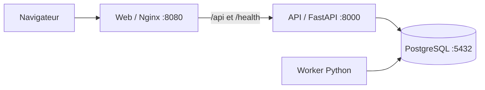
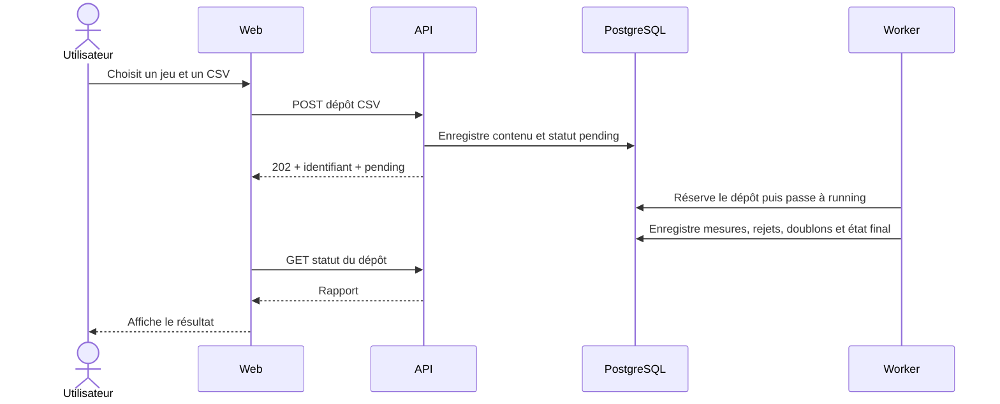

# Dossier de conception — CampusData

- **Membre :** Abdoul Ahad Mbacké DIOUF
- **Version / commit :** à renseigner après le prochain commit
- **Date de revue et relecteur :** à renseigner après une vraie revue

> Ce document décrit une conception cible. Les résultats des tests et des déploiements ne seront ajoutés qu'après observation.

## 1. Besoin et utilisateurs

L'administration reçoit des fichiers CSV contenant des mesures de CO₂, de température et d'humidité produites par les capteurs des salles du campus. Leur copie manuelle dans un tableur prend du temps et peut créer des erreurs et des doublons. CampusData permet à un membre de l'administration de créer un jeu de données, d'y déposer un CSV, de suivre son traitement, de comprendre les lignes rejetées et de consulter des indicateurs par salle. Les jeux, les dépôts et les mesures sont conservés dans PostgreSQL, même après un redémarrage. Le projet est un prototype : pas d'authentification, d'IA ou de traitement en temps réel ; le « responsable » déclaré est un texte libre, pas un compte connecté.

**Parcours de démonstration :** créer un jeu « Mesures du campus » ; déposer le CSV valide ; recevoir `202` et `pending` ; attendre le worker ; lire le rapport `succeeded` et les indicateurs ; redéposer le même fichier et constater que le nombre de mesures ne change pas.

**Cas d'erreur :** déposer le CSV à en-tête invalide ; l'API accepte le dépôt en attente, puis le worker le marque `failed`, fournit une raison compréhensible et n'insère aucune mesure.

| ID | L'utilisateur peut… | C'est réussi quand… |
|---|---|---|
| US01 | Créer un jeu | Il apparaît dans la liste ; un nom déjà pris donne `409`. |
| US02 | Lister et ouvrir les jeux | Le nombre de mesures est visible ; un jeu inconnu donne `404`. |
| US03 | Supprimer un jeu | Une confirmation est demandée ; mesures et dépôts liés disparaissent. |
| US04 | Déposer un CSV | L'API répond `202` et enregistre un dépôt `pending`. |
| US05 | Suivre le traitement | Le worker passe le dépôt à `succeeded` ou `failed`. |
| US06 | Lire les rejets | Chaque ligne rejetée est comptée avec sa raison. |
| US07 | Redéposer un fichier | Aucune mesure n'est insérée deux fois. |
| US08 | Consulter les indicateurs | Les résultats par salle sont filtrables par salle et période. |
| US09 | Relancer un échec | Seul un dépôt `failed` peut être relancé. |
| US10 | Retrouver les données | Elles restent présentes après redémarrage. |

## 2. Backlog et critères d'acceptation

Le responsable prévu des tâches est Abdoul Ahad Mbacké DIOUF. Chaque US comprend réalisation, validation du cas positif et négatif, puis documentation de la preuve. Les noms de tests et les preuves réelles seront ajoutés après exécution.

| ID | Priorité | Étant donné / Quand / Alors | Refus à vérifier | Preuve prévue |
|---|---|---|---|---|
| US01 | Haute | Étant donné un nom libre, quand je crée le jeu, alors il apparaît dans la liste. | Nom déjà pris `409` ; nom invalide `422`. | Test API et relecture. |
| US02 | Haute | Étant donné un jeu, quand je l'ouvre, alors ses détails et son nombre de mesures s'affichent. | Identifiant inconnu `404`. | Tests de liste et de détail. |
| US03 | Haute | Étant donné un jeu, quand je confirme sa suppression, alors l'API répond `204` sans corps et les données liées disparaissent. | Annulation dans l'UI : aucune requête ; jeu inconnu `404`. | Test API avec relecture et contrôle UI. |
| US04 | Haute | Étant donné un jeu et un CSV autorisé, quand je le dépose, alors le dépôt est `pending` et l'API répond `202`. | Jeu inconnu `404`, taille `413`, type `415`, requête invalide `422`. | Tests HTTP et lecture du dépôt. |
| US05 | Haute | Étant donné un dépôt `pending`, quand le worker passe, alors il devient `running` puis final. | Une panne ne doit pas être présentée comme un succès. | Test du worker et relecture. |
| US06 | Haute | Étant donné des lignes invalides, quand le fichier est traité, alors compteur et raisons apparaissent. | Aucune mesure créée pour une ligne rejetée. | Test du rapport et de la base. |
| US07 | Haute | Étant donné un CSV déjà ingéré, quand je le redépose, alors le total de mesures est inchangé. | Les doublons sont comptés séparément des rejets. | Double dépôt et relecture du total. |
| US08 | Haute | Étant donné des mesures, quand je consulte les statistiques, alors je vois les indicateurs filtrables. | Période inversée `422`. | Tests de calcul et des filtres. |
| US09 | Moyenne | Étant donné un dépôt `failed`, quand je le relance, alors il redevient `pending` avec compteurs remis à zéro. | Autre statut `409`, sans mutation. | Tests des transitions et relecture. |
| US10 | Haute | Étant donné des données, quand le service redémarre, alors elles sont retrouvées. | Le volume ne doit pas être supprimé. | Preuve Compose avant/après recréation. |

**Résultats imposés par le sujet :** CSV valide → `succeeded`, 63 acceptées ; CSV avec erreurs → `succeeded`, 4 acceptées, 7 rejetées, 1 doublon ; en-tête invalide → `failed`, 0 mesure ; second dépôt du CSV valide → 0 acceptée, 63 doublons, total toujours égal à 63. Dans le CSV avec erreurs, les lignes physiques 2, 3, 4 et 13 sont valides ; les lignes 5 à 10 et 12 sont rejetées ; la ligne 11 est un doublon de la ligne 3.

## 3. Maquettes et interactions

```text
CampusData                                    Version API : …
[Message : chargement / succès / erreur]

Nouveau jeu : Nom * [____] Description [____] Responsable [____] [Créer]
Jeux : [Nom] [Responsable] [Nombre de mesures] [Ouvrir] [Supprimer]

Jeu sélectionné : …
CSV : [Choisir un fichier] [Déposer]
Dépôt : pending / running / succeeded / failed
Acceptées : …  Rejetées : …  Doublons : …
Lignes rejetées : [numéro] [raison]
[Relancer] seulement si failed

Indicateurs : Salle [____] Du [____] Au [____] [Filtrer]
[Tableau : salle, nombre, CO₂ moyen/min/max,
 température moyenne, humidité moyenne, dernière mesure]
```

Chaque champ a un label visible et lié au champ ; le parcours fonctionne au clavier avec un focus visible. Le tableau possède une légende et des en-têtes. L'interface distingue chargement, liste vide, succès, erreur et API indisponible. Un `202` signifie « reçu et en attente », pas « traité ». Un échec garde les données saisies si possible et donne un message lisible. La confirmation de suppression affiche le nom du jeu ; l'annulation n'envoie aucune requête. Le suivi du dépôt interroge son statut régulièrement et s'arrête à l'état final ou après un nombre borné d'essais annoncé à l'utilisateur. Les textes saisis sont affichés comme du texte, sans interprétation HTML.

**Réalisation S2 :** captures dans `proofs/s2-interface-*.png`. Le parcours clavier, l'annulation de suppression, l'erreur réseau, le suivi d'un dépôt et le rendu mobile ont été contrôlés dans Chromium.

## 4. Architecture et flux



Le navigateur entre par le service web. Nginx sert l'interface et transmet les appels à l'API. L'API enregistre le CSV et le dépôt puis répond `202`. Le worker, processus séparé, lit les dépôts en attente, contrôle le CSV et enregistre les mesures et le rapport. Le contenu du CSV est conservé en base pour être accessible aux deux processus.



```mermaid
sequenceDiagram
  actor U as Utilisateur
  participant A as API
  participant D as PostgreSQL
  U->>A: POST /api/ingestions/{id}/retry
  A->>D: Lit et verrouille le dépôt
  D-->>A: Statut succeeded
  A-->>U: 409 Conflit
  Note over A,D: Aucun changement ; rollback si transaction ouverte
```

| Contexte | Point d'entrée | Accès API | DB vue par l'API | Stockage durable |
|---|---|---|---|---|
| Développement S1–S2 | `127.0.0.1:8080` via proxy ; API locale `:8000` | Poste local | `127.0.0.1:5432` | Volume DB Compose dev |
| Compose S3 | `127.0.0.1:8080` | Service interne `api:8000` | `db:5432` | Volume nommé PostgreSQL |
| k3d S4 | `127.0.0.1:8081` | Service Kubernetes interne | Service `db:5432` | PVC PostgreSQL |
| AWS/K3s S5–S6 | `127.0.0.1:8082` par tunnel SSH | Service Kubernetes interne | Service `db:5432` | PVC sur la VM |

En Compose et Kubernetes, seul le web est le point d'entrée du navigateur ; API et DB restent internes. Ces adresses sont celles prévues par le kit et seront contrôlées dans chaque environnement.

## 5. Données et contrat

| Table | Champs principaux | Contraintes prévues |
|---|---|---|
| `datasets` | `id` UUID, `name` texte, `description` texte nullable, `owner` texte nullable, `created_at` date avec fuseau | Clé primaire `id` ; `name` obligatoire et unique. |
| `ingestions` | `id` UUID, `dataset_id` UUID, `filename`, `status`, `content` CSV, `rows_accepted`, `rows_rejected`, `rows_duplicate`, `errors` JSON, `created_at`, `started_at`, `finished_at` | FK `dataset_id` avec suppression en cascade ; compteurs par défaut à 0 ; statut limité à `pending`, `running`, `succeeded`, `failed`. |
| `measurements` | `id` UUID, `dataset_id` UUID, `ingestion_id` UUID, `room`, `measured_at` avec fuseau, `co2_ppm`, `temperature_c`, `humidity_pct` | FK vers jeu et dépôt ; unicité `(dataset_id, room, measured_at)`. |

Choix proposé : UUID produits en Python par `uuid4`, horodatages produits en UTC ; `description`, `owner`, `started_at` et `finished_at` peuvent être nuls. Les identifiants, clés étrangères, nom, fichier, statut et valeurs de mesure sont obligatoires. Les compteurs ne peuvent pas être négatifs. L'unicité des mesures protège l'idempotence. `create_all` initialise un schéma absent, mais ne migre pas un schéma existant.

| Statut actuel | Action | Statut suivant | Résultat |
|---|---|---|---|
| `pending` | Réservation par le worker | `running` | Autorisé |
| `running` | Traitement terminé | `succeeded` | Autorisé |
| `running` | Fichier inutilisable ou échec | `failed` | Autorisé |
| `failed` | Relance par l'utilisateur | `pending` | Autorisé ; remettre compteurs et erreurs à zéro |
| `pending`, `running`, `succeeded` | Relance | Aucun changement | Refus `409` |

Des lignes invalides dans un fichier dont l'en-tête est correct produisent des rejets et peuvent aboutir à `succeeded`. Un en-tête invalide rend le dépôt `failed`.

**CSV attendu :** `room,measured_at,co2_ppm,temperature_c,humidity_pct`, séparateur virgule. Contrôler l'en-tête et le nombre de colonnes, la salle non vide, l'horodatage ISO avec fuseau et non futur, les nombres, le CO₂ non négatif et l'humidité entre 0 et 100. Une ligne invalide est comptée comme rejet avec son numéro et sa raison ; une mesure valide dont la clé existe déjà est un doublon. Le décompte du fichier mixte est confirmé par test. Les éventuelles bornes supplémentaires et le traitement contractuel des lignes vides restent à confirmer avant la remise.

| Méthode et route | Succès | Erreurs principales |
|---|---|---|
| `POST /api/datasets` | `201` et jeu créé | `409`, `422` |
| `GET /api/datasets` | `200`, liste avec `measurement_count` | — |
| `GET /api/datasets/{id}` | `200`, détail | `404` |
| `DELETE /api/datasets/{id}` | `204` sans corps | `404` |
| `POST /api/datasets/{id}/ingestions?filename=...` | `202`, `pending` | `404`, `413`, `415`, `422` |
| `GET /api/datasets/{id}/ingestions` | `200`, liste | `404` |
| `GET /api/ingestions/{id}` | `200`, statut et rapport | `404` |
| `POST /api/ingestions/{id}/retry` | Dépôt remis à `pending` | `404`, `409` |
| `GET /api/datasets/{id}/stats?room=&from=&to=` | `200`, indicateurs par salle | `404`, `422` |
| `GET /health/live` | `200`, processus actif | — |
| `GET /health/ready` | `200`, DB et tables accessibles | `503` |
| `GET /api/version` | `200`, version | — |

Le dépôt envoie le CSV brut avec `Content-Type: text/csv`, sans multipart. La limite envisagée est 1 Mio côté API ; au-dessus : `413`. Les statistiques comprennent nombre de mesures, CO₂ moyen/min/max, moyennes de température et d'humidité et dernière mesure. Les filtres `from` et `to` sont des dates avec fuseau ; une période inversée donne `422`.

```http
POST /api/datasets
Content-Type: application/json

{"name":"Mesures du campus","description":"Salles du campus","owner":"Administration"}
```

Réponse prévue : `201`, identifiant et informations du jeu.

```http
POST /api/datasets/{id}/ingestions?filename=mesures.csv
Content-Type: text/csv

room,measured_at,co2_ppm,temperature_c,humidity_pct
...
```

Réponse prévue : `202`, identifiant et `status: "pending"`. Une relance sur un dépôt `succeeded` donne `409` sans mutation ; un fichier trop grand donne `413` ; une suppression donne `204` sans corps.

**Codes d'erreur :** `404` ressource inconnue ; `409` conflit métier ; `413` fichier trop grand ; `415` type non accepté ; `422` données ou paramètres invalides ; `503` DB indisponible ou tables absentes pour la readiness ; `500` erreur inattendue avec message public générique, sans secret ni chaîne de connexion.

## 6. Découpage du code et transactions

| Module | Responsabilité prévue | Invariant et test associé |
|---|---|---|
| `database.py` | Engine et sessions SQLAlchemy | Une session par requête, fermée même sur erreur ; test de panne. |
| `models.py` | Trois tables et contraintes SQL | Unicité, FK, cascade ; tests de contraintes et suppression. |
| `schemas.py` | Entrées et sorties Pydantic | Corps invalide refusé avec `422`. |
| `ingestion.py` | Lecture et validation CSV | Chaque ligne classée une fois ; tests avec les trois CSV. |
| `services.py` | Règles métier et accès DB | Mutation refusée sans effet partiel ; tests avec relecture. |
| `routes.py` | Routes et traduction des erreurs en HTTP | Codes et corps conformes ; tests API. |
| `worker.py` | Réservation et traitement des dépôts | Deux workers ne prennent pas le même dépôt ; tests de traitement. |
| `init_db.py` | Création explicite des tables | Deux exécutions ne détruisent rien ; test répété. |
| `main.py` | Assemblage et probes | Liveness sans DB ; readiness avec DB et tables ; tests des deux cas. |

Choix de transaction proposé : le service métier fait un `commit` à la fin d'une unité de travail et un `rollback` en cas d'échec ; la dépendance ferme toujours la session. Le worker a ses propres sessions. Il réserve un dépôt avec un verrou de ligne (`FOR UPDATE SKIP LOCKED`), passe à `running`, traite, puis enregistre compteurs et état final. L'unicité SQL des mesures empêche les doublons, même si deux traitements se concurrencent. Le placement exact des transactions et le cas d'un arrêt brutal du worker seront revus avec le code réel.

## 7. Décisions argumentées

| Décision | Choix | Motif | Limite | Preuve prévue |
|---|---|---|---|---|
| Traitement asynchrone | API et worker distincts | Réponse `202` rapide, traitement différé. | Suivi du statut nécessaire. | Dépôt et observation du worker. |
| Stockage du CSV | Contenu en PostgreSQL | Accessible aux deux processus sans disque partagé. | Taille de DB et limite de fichier. | Dépôt puis traitement séparé. |
| Base relationnelle | PostgreSQL | Transactions, FK et unicité. | Dépendance à la disponibilité DB. | Tests de contraintes et persistance. |
| Idempotence | Clé unique `(dataset_id, room, measured_at)` | Second dépôt sans nouvelle mesure. | Deux relevés de même salle/date sont considérés identiques. | Deux dépôts, total toujours 63. |
| Réservation | `SKIP LOCKED` | Deux workers ne prennent pas le même dépôt. | Transactions à gérer soigneusement. | Essai avec plusieurs workers. |
| Initialisation | `python -m app.init_db` | Schéma explicite, hors démarrage API. | `create_all` ne migre pas. | Deux exécutions sans perte. |
| Probes distinctes | Live sans SQL, ready avec SQL et tables | Panne DB visible sans redémarrage inutile de l'API. | Ready dépend de l'initialisation. | Tests DB/table absentes. |
| Origine navigateur | Web Nginx et proxy `/api` | Parcours identique selon l'environnement. | Proxy à configurer. | Parcours navigateur. |

Ces choix seront corrigés dans ce dossier si l'implémentation réelle diffère.

## 8. Risques et mesures

| Risque | Effet utilisateur | Détection | Mesure prévue | Limite restante |
|---|---|---|---|---|
| Panne API | Requêtes impossibles | Navigateur, probes, logs | Redémarrage et diagnostic | Requête en cours possiblement perdue |
| Panne DB | Lecture, écriture et traitement impossibles | Ready `503`, logs | Volume durable, sauvegarde et restauration | Indisponibilité temporaire |
| Arrêt du worker | Dépôts bloqués | Statuts anciens, logs | Redémarrage et diagnostic | Reprise des dépôts `running` à définir |
| Perte du nœud | Application et DB absentes | Nœud/VM inaccessible | Sauvegarde et restauration dans une cible distincte | Prototype à nœud unique |
| Secret exposé | Accès non autorisé | Revue Git/configuration | `.env` hors Git, Secret séparé, preuves expurgées | Rotation nécessaire après exposition |
| Ressource AWS oubliée | Coût prolongé | Inventaire AWS | Clôture documentée et preuve de suppression | Vérification finale nécessaire |
| CSV invalide ou trop grand | Import échoué ou ralenti | Validation et rapport | Taille limitée, contrôles de format | Règles exactes à figer |

Ne pas supprimer un volume PostgreSQL ou un PVC durant une preuve de persistance. Tester une restauration dans une base distincte avant de la présenter comme validée.

## 9. Validation croisée et suivi des écarts

**Revue de conception :** à réaliser. Le relecteur vérifiera les US, les codes HTTP, les CSV, les transitions, les frontières réseau et la cohérence avec le code livré.

**Décompte CSV clarifié :** l'examen des 12 lignes de données donne 4 valides (lignes physiques 2, 3, 4 et 13), 7 invalides (5 à 10 et 12) et 1 doublon interne (11). Une note interne du dépôt indiquait un autre décompte ; le sujet officiel et le contenu du fichier concordent. Il reste à confirmer les éventuelles bornes numériques supplémentaires du contrat avant la remise.

**Différences conception / réalisation :** à renseigner pendant S2–S6 avec décision modifiée, raison, commit et test.

**Questions ouvertes :** bornes numériques complètes pour CO₂ et température ; reprise d'un dépôt resté `running` après arrêt brutal ; format exact des statistiques et des erreurs de ligne. Ces points seront résolus par le contrat détaillé, puis par le code et les tests. Aucun n'est présenté comme déjà validé.


## 10. État de la réalisation S2

Les modules `database.py`, `models.py`, `schemas.py`, `init_db.py`, `ingestion.py`, `services.py`, `routes.py` et `worker.py` sont présents. L'API expose les routes métier, et `/health/ready` vérifie la présence des trois tables. Le worker fonctionne en boucle ou vide la file avec `--once`. L’interface permet création, suppression avec confirmation, dépôt CSV, suivi, relance, lecture des rejets et indicateurs filtrés. Une extension de S2 organise ces fonctions en vues Dépôts, Rapport, Indicateurs et gestion des jeux ; le dépôt direct et la suppression d’un dépôt terminé suivent la maquette. Les erreurs API ne contiennent que ligne et raison, donc les colonnes salle/champ/valeur de la maquette ne peuvent pas être affichées sans changer le contrat.

La preuve `proofs/s2-api-tests.txt` consigne 14 tests réussis sur `campus_test`, les contrôles HTTP via Nginx et les parcours Chromium. Les captures `proofs/s2-interface-desktop.png`, `proofs/s2-interface-traitee.png`, `proofs/s2-interface-mobile.png` et `proofs/s2-interface-erreur.png` montrent les états observés. Les jeux créés pour les contrôles navigateur ont été supprimés après vérification.

La reprise automatique d'un dépôt resté `running` après un arrêt brutal du worker n'est pas réalisée. La persistance après redémarrage et les environnements S3–S6 n'ont pas encore été testés. L'étudiant doit relire le code produit avec l'aide de l'IA avant la remise.
